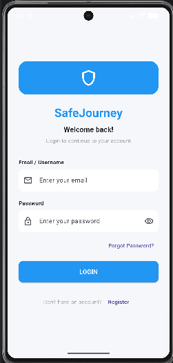
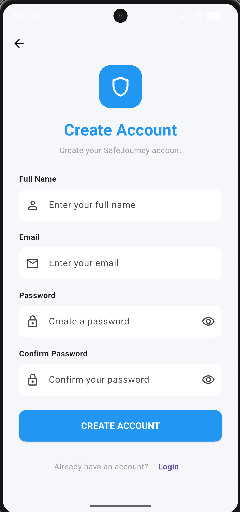

# SafeJourney Flutter Login & Registration

## Description

SafeJourney is a Flutter application that provides a simple and user-friendly Login and Registration interface. It demonstrates form validation, password visibility, navigation, and a clean mobile-friendly design.

## Features

- Login interface
- Registration interface
- Email validation
- Password validation
- Show/Hide password
- Confirm password validation
- Forgot Password option
- Navigation between Login and Registration
- Clean and responsive UI

## Screenshots

### Login Page



### Registration Page



## Technologies Used

- Flutter
- Dart
- Material Design
- Android Studio
- Android Emulator

## How to Run

1. Clone the repository.
2. Open the project in Android Studio.
3. Run `flutter pub get`.
4. Start an Android emulator.
5. Run `flutter run`.

## Project Structure

```text
safejourney_login/
├── android/
├── lib/
│   └── main.dart
├── screenshots/
│   ├── login.png
│   └── registration.png
├── pubspec.yaml
├── README.md
└── .gitignore